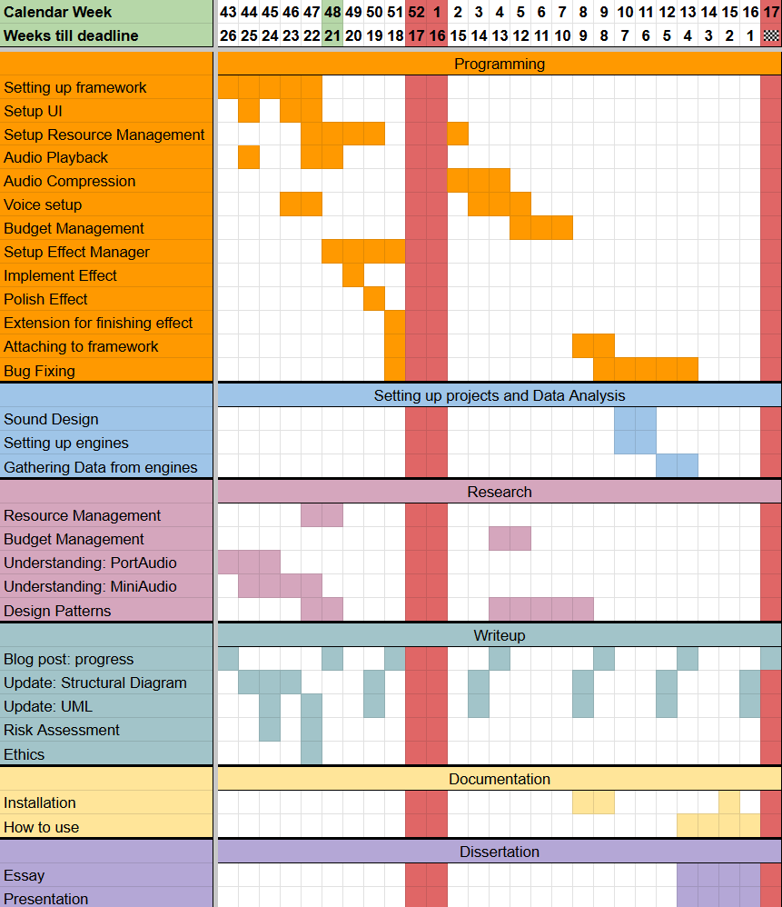
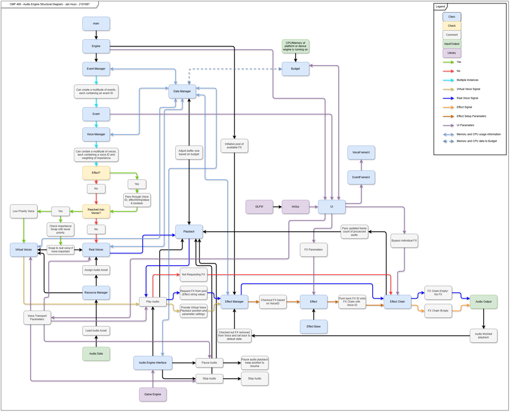
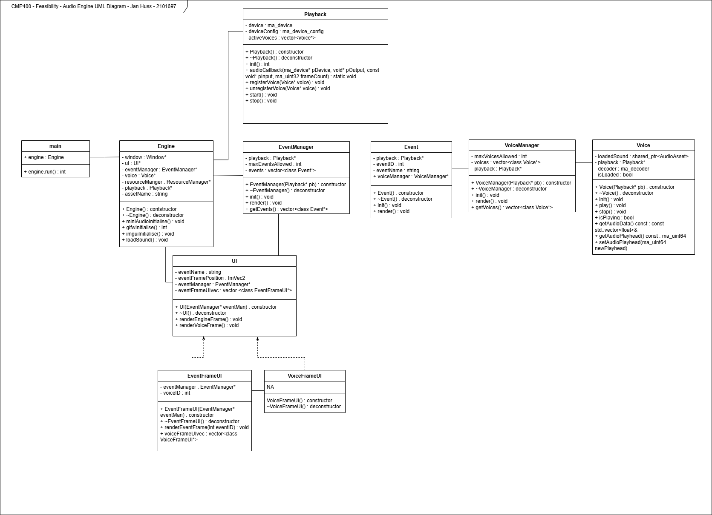

🖥️ [View the GitHub Repository](https://github.com/JanHuss/newMaginengineAudio) | 🎮 [Check out my other projects](https://janhuss.github.io/categories/)

# Introduction

For my **honours project**, I set out to design and build an **audio engine for video games** 
with a focus on **memory allocation and efficiency**.

The project was inspired by [Rockstar’s RAGE Audio GDC talk](https://youtu.be/PqPaP_09Pwg?si=ztXVmpbTX-4Z7oDK), 
which first introduced me to the idea of **audio budgets** — an essential part of optimizing 
game audio. Throughout this journey, I aimed to:

- **Understand the structure of an audio engine.**
- **Analyze how asset usage can stay within a given budget.**
- **Implement the audio engine into a simple game to showcase the complexity behind triggering audio data.**

This blog documents the **key milestones, research, and challenges** I faced while developing 
this system. Although the honours deadline has passed the project is **still ongoing** and will be **updated over time**. With time, I hope that the audio engine can act as an educational tool for anyone interested in building their own.

# Research & Project Proposal

Before development, I was required to submit a **project proposal**, detailing:

- **What I am building**: An **audio engine optimized for CPU and memory efficiency**.
- **Why this matters**: Audio optimization is a **key factor in game development**, and I wanted 
to **explore how to build an efficient system from the ground up**.
- **How I would approach it**: Researching **audio engine architecture** and working with 
existing libraries to compare performance.

## Resources & Inspiration

To prepare, I explored multiple **books and talks** on game audio programming:

- **Game Audio Programming** (Guy Somberg – Vol. 1-4)
- **From Beep to Boom** (Simon Goodwin)
- **Game Engine Architecture** (Jason Gregory)

I also tested **different audio libraries**:

- **PortAudio** – Good for loading data but not ideal for real-time playback.
- **Miniaudio** – A lightweight single-header library supporting multi-format playback.

After gathering research, I submitted my proposal, marking the start of development.

# Feasibility Demo – Proving the Project’s Viability

The next major milestone was the **Feasibility Demo**, where I had to prove that my project was achievable by showcasing early progress.

## Required Deliverables:

- **A Gantt chart** outlining tasks until final submission.
- **Research question and project scope updates.**
- **A running application showing core functionality.**
- **A UML diagram and structural breakdown of the engine.**

### Gantt Chart

{: width="600" .w-5 .normal } 

### Structure Diagram

{: width="600" .w-5 .normal } 

### UML Diagram

{: width="600" .w-5 .normal } 

# Technical Development & Key Changes

The initial development process involved setting up a repository and experimenting with different audio playback systems.

- Originally, I used **PortAudio for loading** and **Miniaudio for playback**, but I later 
**removed PortAudio entirely**.
- **Why?**
  1. Miniaudio could handle both **loading and playback**, simplifying the structure.
  2. It was easier to **understand one system deeply** rather than working with two.
  3. PortAudio’s **.lib file was causing repository issues**, making cross-device work 
  frustrating.

After removing **PortAudio**, my **productivity and motivation improved**, allowing me to focus more on **developing the engine**.

# Redesigning the audio engine

During development, I bottlenecked the engine. It was still maintainable but I quickly realised that there were two options available to me:
1. Refactor the code and keep on working on a complex software
2. Redesign the engine and investigate how to optimise its complexity

Given that I have been told in the past how peers have talked about building multiple engines until they reached a conclusive and stable build, I decided to take a step back and start the audio engine from the beginning again. Would this set me back by almost an entire term? Yes. But it turned out to be a necessary step in order for me to realise why I bottlenecked in the first place. It made me re-evaluate my software design skills and it allowed me to explore various, useful design patterns such as the **Composite Design Patter** and **Object Pool Patterns**, but also discover various C++ options such as **Function Pointers**.

Long story short, starting from the beginning was part of the process all along.

# Final Thoughts & Future Plans

This project reinforced my **passion for audio programming** and **game engine development** but also helped re-evaluate my software design skills and discover new areas within C++ code.

Key takeaways:

- Audio engine optimization is **both an art and a science** — balancing performance, 
memory, and functionality.
- There is still so much to explore — I plan to **continue developing this engine** until I can consider it stable and free from the miniaud.io library.

**The honours project was just the starting point of this journey into game audio engine development! More updates will follow as development continues.**
